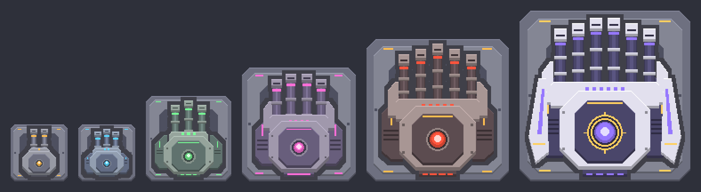

# Rapid Arsenal (Mindustry mod): turrets, walls, drills, mechs

Six tiers of extremely fast turrets (Turrets tab):

| Tier | Size | Barrels | Shots / second | Range | Ammo |
|------|------|---------|----------------|-------|------|
| I    | 2x2  | 2       | 20             | 190   | copper, graphite, silicon |
| II   | 2x2  | 3       | 25             | 210   | copper, graphite, silicon |
| III  | 3x3  | 3       | 32             | 235   | copper, graphite, silicon |
| IV   | 4x4  | 4       | 40             | 265   | + thorium (piercing) |
| V    | 5x5  | 5       | 60             | 300   | + thorium (piercing) |
| VI   | 6x6  | 6       | 120            | 340   | + surge alloy (lightning) |

Graphite hits harder, silicon homes in and fires faster. Water/cryofluid cooling boosts fire rate.
Barrels glow in the tier colour while firing.

## Build cost

Prices follow firepower: each tier costs (its best sustained DPS) x (cost per DPS), and cost per
DPS rises with the tier like it does for vanilla turrets. `python3 tools/gen.py --balance` prints the numbers.

| Tier | Cost |
|------|------|
| I    | 250 copper, 120 graphite, 100 silicon |
| II   | 400 copper, 220 graphite, 180 silicon, 100 titanium |
| III  | 800 copper, 450 graphite, 400 silicon, 350 titanium, 200 thorium |
| IV   | 1500 copper, 800 graphite, 700 silicon, 700 titanium, 600 thorium, 450 plastanium, 150 surge alloy |
| V    | 2500 copper, 1400 graphite, 1300 silicon, 1300 titanium, 1100 thorium, 900 plastanium, 700 surge alloy |
| VI   | 4000 copper, 2500 graphite, 3000 silicon, 3000 titanium, 2500 thorium, 2200 plastanium, 2200 surge alloy, 1200 phase fabric |

Research: Rapid I sits under the Duo in the Serpulo tech tree, and every tier unlocks the next one
(Duo -> I -> II -> III -> IV -> V -> VI). Research cost is derived from the build cost.
In sandbox everything is available right away.

You can take direct control of any tier: tap/click the turret (no build tool selected) and
aim/shoot yourself.

## Walls

Ten walls (Defense tab): `Rapid Wall I-V` (1x1) and `Large Rapid Wall I-V` (2x2, 4x health and 4x cost).

| Tier | Health / tile | Armor | Cost / tile | Special |
|------|---------------|-------|-------------|---------|
| I | 420 | 0 | 6 copper, 2 graphite | - |
| II | 640 | 0 | 6 titanium, 3 silicon | - |
| III | 920 | 2 | 6 thorium, 4 titanium | - |
| IV | 1250 | 4 | 5 plastanium, 5 thorium | absorbs lasers, insulated |
| V | 1700 | 6 | 6 surge alloy, 3 phase fabric | deflects bullets, arcs lightning |

Research: Rapid Wall I after the Copper Wall, every tier after the previous one, large walls after their small wall.

## Drills

Five drills (Production tab), all accept water as an optional booster.

| Tier | Size | Mines up to hardness | Drill time | Power | Water / tick | Cost |
|------|------|----------------------|------------|-------|--------------|------|
| I | 2x2 | 2 | 430 | - | 0.05 | 30 copper, 15 graphite |
| II | 2x2 | 3 | 320 | - | 0.06 | 45 copper, 30 graphite, 15 silicon |
| III | 3x3 | 4 | 230 | 1.5 | 0.09 | 60 copper, 50 graphite, 45 silicon, 35 titanium |
| IV | 4x4 | 5 | 190 | 4 | 0.12 | 110 copper, 90 silicon, 80 titanium, 90 thorium |
| V | 5x5 | 6 | 150 | 8 | 0.16 | 200 copper, 180 silicon, 150 titanium, 150 thorium, 60 plastanium, 40 surge alloy |

Research: Rapid Drill I after the Mechanical Drill, then in order.

## Mech units and the Rapid Forge

The **Rapid Forge** (5x5, Units tab, 2.5 power/tick; cost 350 copper, 250 lead, 150 graphite, 200 silicon; researched after the Ground Factory) builds five ground mechs with rapid-fire guns.

| Tier | Unit | Health | Armor | Speed | Gun reload | Bullet damage | Build time (s) | Build cost |
|------|------|--------|-------|-------|-----------|---------------|----------------|-----------|
| 1 | Pellet | 170 | 0 | 0.55 | 8 | 5 | 20 | 25 silicon, 15 lead, 10 graphite |
| 2 | Burst | 620 | 3 | 0.5 | 6 | 9 | 40 | 80 silicon, 50 graphite, 30 titanium |
| 3 | Volley | 1200 | 6 | 0.43 | 5 | 14 | 70 | 220 silicon, 160 titanium, 120 graphite, 40 thorium |
| 4 | Barrage | 8500 | 9 | 0.36 | 4 | 27 | 150 | 900 silicon, 750 titanium, 450 plastanium, 300 thorium |
| 5 | Storm | 22000 | 14 | 0.32 | 3 | 48 | 240 | 1400 silicon, 800 plastanium, 600 surge alloy, 500 thorium, 350 phase fabric |

Unit research: Pellet after the Rapid Forge, every unit after the previous one (research costs are set per unit).

## Conveyors

`Rapid Conveyor I-V` (Distribution tab). Research: I after the Conveyor, then in order.

| Tier | Items/s | Speed | Health | Cost per tile |
|------|---------|-------|--------|---------------|
| I | 7 | 0.05 | 50 | 1 copper, 1 graphite |
| II | 12 | 0.085 | 70 | 1 copper, 1 lead, 1 titanium, 1 silicon |
| III | 16 | 0.115 | 100 | 1 titanium, 1 silicon, 1 thorium |
| IV | 21 | 0.15 | 140 | 1 plastanium, 1 thorium, 1 silicon |
| V | 26 | 0.19 | 190 | 1 plastanium, 1 surge alloy, 1 phase fabric |

## Air units and the Rapid Hangar

The **Rapid Hangar** (5x5, Units tab, 3 power/tick; cost 300 copper, 300 lead, 150 graphite, 220 silicon, 100 metaglass; researched after the Air Factory) builds five rapid-fire gunships. Tempest and Hurricane carry turning turrets.

| Tier | Unit | Health | Armor | Speed | Gun reload | Bullet damage | Build time (s) | Build cost |
|------|------|--------|-------|-------|-----------|---------------|----------------|-----------|
| 1 | Dart | 80 | 0 | 2.9 | 9 | 4 | 15 | 20 silicon, 10 lead |
| 2 | Swift | 360 | 2 | 2.0 | 7 | 8 | 35 | 60 silicon, 45 graphite, 20 titanium |
| 3 | Falcon | 750 | 5 | 1.7 | 5 | 13 | 65 | 200 silicon, 140 titanium, 100 graphite, 60 metaglass |
| 4 | Tempest | 7200 | 9 | 0.85 | 4 | 25 | 140 | 950 silicon, 800 titanium, 600 plastanium, 250 thorium |
| 5 | Hurricane | 22000 | 13 | 0.55 | 4 | 34 | 230 | 1500 silicon, 850 plastanium, 600 surge alloy, 400 phase fabric, 400 thorium |

Unit research: Dart after the Rapid Hangar, every unit after the previous one (research costs are set per unit).

Pure JSON (hjson) mod with no Java/JS, so it also works on **iOS**.

Everything in `content/`, `sprites/` and `bundles/` is generated by `python3 tools/gen.py`
(needs Pillow).

Install: zip the *contents* of this folder (`mod.json` at zip root) and import it
in-game: Mods -> Import Mod/File.

## Pulse turrets (power, no ammo)

| Tier | Size | Shots/s | Damage | Range | Power/s | Cost |
|------|------|---------|--------|-------|---------|------|
| I   | 1x1 | 12 | 9  | 130 | 150  | 90 copper, 90 lead, 40 silicon |
| II  | 2x2 | 20 | 13 | 175 | 360  | 150 copper, 150 lead, 120 silicon, 80 titanium |
| III | 3x3 | 30 | 17, pierces 2 | 215 | 780  | 400 copper, 400 lead, 320 silicon, 260 titanium, 100 thorium |
| IV  | 4x4 | 60 | 20, pierces 3 | 250 | 1560 | 1000 copper, 900 lead, 800 silicon, 700 titanium, 350 thorium, 200 plastanium, 100 surge alloy |

## Buckshot turrets (rapid shotguns)

| Tier | Size | Pellets | Volleys/s | Range | Ammo | Cost |
|------|------|---------|-----------|-------|------|------|
| I   | 1x1 | 3 | 5  | 95  | scrap, graphite | 80 copper, 60 lead, 40 graphite |
| II  | 2x2 | 4 | 6.7 | 115 | scrap, graphite | 250 copper, 150 lead, 120 graphite, 70 titanium |
| III | 3x3 | 5 | 8.6 | 135 | + thorium (piercing) | 600 copper, 400 graphite, 350 titanium, 220 thorium |
| IV  | 4x4 | 7 | 12 | 160 | + thorium (piercing) | 1400 copper, 900 graphite, 800 titanium, 600 thorium, 350 plastanium, 150 surge alloy |

## Aegis shield walls (need power, pass it on to touching shield walls)

| Tier | Health/tile | Shield/tile | Cost/tile |
|------|-------------|-------------|-----------|
| I   | 300  | 120 | 6 copper, 3 silicon |
| II  | 480  | 220 | 6 titanium, 4 silicon |
| III | 700  | 380 | 6 thorium, 2 plastanium, 4 silicon |
| IV  | 1000 | 600 | 6 surge alloy, 3 phase fabric, 4 silicon (also deflects bullets) |

## Regen walls (repair themselves, no power)

| Tier | Health/tile | Self-repair | Cost/tile |
|------|-------------|-------------|-----------|
| I   | 300 | 2 %/s | 6 lead, 2 silicon |
| II  | 460 | 3 %/s | 6 titanium, 4 silicon |
| III | 680 | 4 %/s | 6 thorium, 2 phase fabric, 4 silicon |

Every wall comes in 1x1 and 2x2. Research: Pulse from Arc, Buckshot from Hail, Aegis from Rapid Wall I, Regen from Mender.
